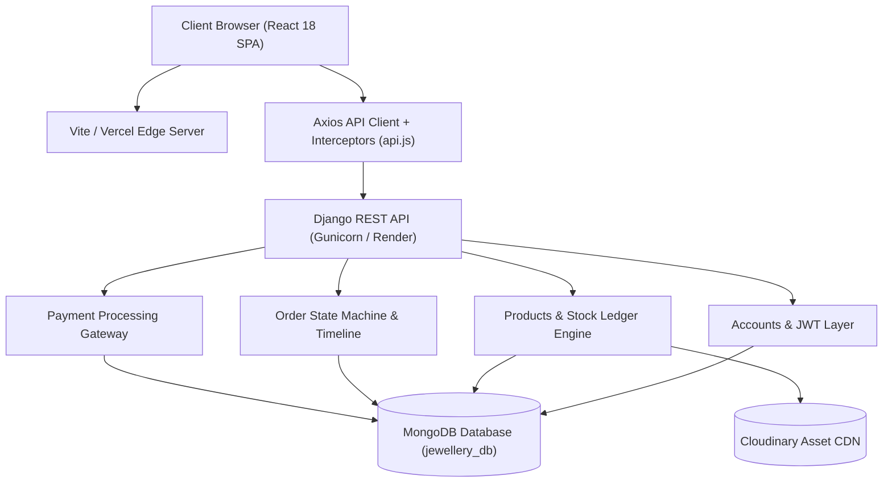
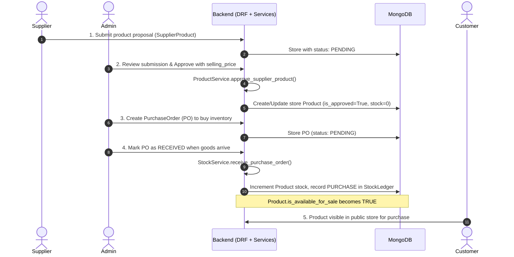
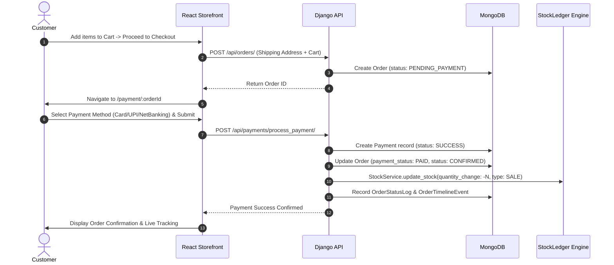
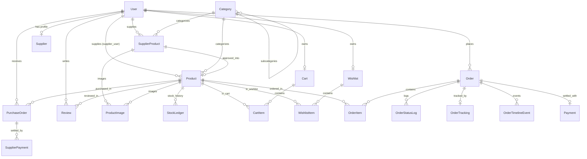

# 💎 LuxeJewels: Multi-Vendor Jewellery Marketplace
## Comprehensive Architectural, Technical, and Codebase Documentation

---

## 1. Executive Project Summary

**LuxeJewels** is a full-stack, enterprise-grade **Multi-Vendor B2B2C Jewellery E-Commerce Marketplace**. It bridges high-end jewellery manufacturers/suppliers, marketplace administrators, and retail customers with real-time precious metal pricing calculations, a multi-tier inventory and approval engine, automated stock ledger tracking, and an end-to-end order processing lifecycle.

### Core Business Model:
1. **Suppliers (Vendors)**: Onboard onto the platform, showcase their crafted jewellery designs, set wholesale cost prices, purity, diamond clarity grades, and submit stock for marketplace listing.
2. **Marketplace Admin**: Curates the catalog, reviews and approves/rejects supplier submissions, sets consumer retail prices and profit margins, issues Purchase Orders (POs) for stock acquisition, receives goods into the physical warehouse, and audits stock ledger movements.
3. **Retail Customers**: Browse catalog items with live fluctuating gold/silver rates, customize purity, add to cart/wishlist, apply promotional discount coupons, checkout with automated tax and shipping calculations, complete payments, and track order logistics in real-time.

---

## 2. Technology Stack & Key Integrations

| Layer | Technology | Key Capabilities & Rationale |
| :--- | :--- | :--- |
| **Backend Framework** | **Django 5.x & Django REST Framework (DRF)** | Robust, scalable RESTful API architecture with built-in ORM, admin capabilities, and authentication backends. |
| **Database** | **MongoDB (via `django_mongodb_backend`)** | High-performance NoSQL document database, offering flexible schema capabilities for intricate jewellery specifications. |
| **Media & Storage** | **Cloudinary (`cloudinary_storage`)** | Cloud media storage with automated optimization, HTTPS transformations, and automated deletion hooks via Django signals. |
| **Authentication** | **SimpleJWT (JSON Web Tokens)** | Stateless token-based auth with 1-hour access token lifespan, 7-day refresh token rotation, and custom claim injections. |
| **Frontend Framework** | **React 18 + Vite** | Blazing-fast Single Page Application (SPA) development with lazy-loaded code-splitting and hot module replacement. |
| **Styling & Icons** | **TailwindCSS & Lucide React** | Modern luxury design system with bespoke typography, glassmorphism, responsive navigation, and crisp iconography. |
| **State & Data Fetching** | **TanStack React Query & Context API** | Optimistic UI updates, automated stale-time caching, smart polling intervals for live order and stock updates. |
| **Animations & Forms** | **Framer Motion & React Hook Form** | Micro-interactions, smooth modal transitions, animated alerts, and performant schema-validated forms. |

---

## 3. High-Level System Architecture & Flow Diagrams

### 3.1 Architectural Topology



---

### 3.2 B2B Supplier-to-Store Product Lifecycle



---

### 3.3 B2C Order, Payment, and Fulfillment Lifecycle



---

## 4. Directory & File Breakdown

```
jewellery-marketplace/
├── backend/                             # Django REST Framework Backend
│   ├── manage.py                        # Django administrative CLI runner
│   ├── requirements.txt                 # Python dependencies
│   ├── build.sh                         # Deployment build script for hosting
│   ├── .env                             # Environment secrets (Mongo URI, Cloudinary, Keys)
│   ├── .gitignore                       # Git exclusion rules
│   ├── config/                          # Central Django Configuration Project
│   │   ├── asgi.py                      # ASGI entry point for async servers
│   │   ├── wsgi.py                      # WSGI entry point for WSGI servers
│   │   ├── urls.py                      # Root URL router & health checks
│   │   └── settings/                    # Modularized Django settings
│   │       ├── base.py                  # Core installed apps, JWT, Cloudinary settings
│   │       ├── dev.py                   # Development settings (DEBUG=True, MongoDB dev)
│   │       └── prod.py                  # Production settings (WhiteNoise, secure cookies)
│   ├── accounts/                        # Authentication, Role Management & Custom User
│   │   ├── models.py                    # Custom User model (ADMIN, SUPPLIER, CUSTOMER)
│   │   ├── views.py                     # Register, Login, Profile, Admin User Management
│   │   ├── serializers.py               # User and Auth Serializers
│   │   ├── permissions.py               # Custom role permission classes
│   │   ├── backends.py                  # Email-based authentication backend
│   │   ├── fields.py                    # DRF ObjectIdField for MongoDB
│   │   ├── base_serializers.py          # Base serializer handling MongoDB ObjectId
│   │   ├── renderers.py                 # Custom MongoJSONRenderer for ObjectId serialization
│   │   └── urls.py                      # /api/accounts/ endpoints
│   ├── products/                        # Product Catalog, POs, and Inventory Ledger
│   │   ├── models.py                    # SupplierProduct, Product, ProductImage, PurchaseOrder, StockLedger
│   │   ├── views.py                     # Product CRUD, PO management, Ledger view
│   │   ├── serializers.py               # Product & Inventory Serializers
│   │   ├── services.py                  # Atomic StockService & ProductService engines
│   │   ├── permissions.py               # Catalog and supplier action permissions
│   │   └── urls.py                      # /api/products/ endpoints
│   ├── categories/                      # Product Categorization Engine
│   │   ├── models.py                    # Category model with hierarchical parents & slugs
│   │   ├── views.py                     # Public & Admin Category management
│   │   ├── serializers.py               # Category serialization
│   │   └── urls.py                      # /api/categories/ endpoints
│   ├── cart/                            # Shopping Cart & Line Item Management
│   │   ├── models.py                    # Cart & CartItem models
│   │   ├── views.py                     # Cart CRUD, current cart lookup, item quantity sync
│   │   ├── serializers.py               # Cart serialization with dynamic product subtotals
│   │   └── urls.py                      # /api/cart/ endpoints
│   ├── wishlist/                        # Customer Saved Items / Wishlist
│   │   ├── models.py                    # Wishlist & WishlistItem models
│   │   ├── views.py                     # Toggle wishlist items, list saved items
│   │   ├── serializers.py               # Wishlist serialization
│   │   └── urls.py                      # /api/wishlist/ endpoints
│   ├── orders/                          # Orders, Tracking, Timeline & Actions
│   │   ├── models.py                    # Order, OrderItem, OrderStatusLog, OrderTracking, OrderTimelineEvent
│   │   ├── views.py                     # Order creation, listing, customer/admin transitions
│   │   ├── serializers.py               # Full & list serializers for orders
│   │   └── urls.py                      # /api/orders/ endpoints
│   ├── payments/                        # Payment Gateway Simulation & Auditing
│   │   ├── models.py                    # Payment model linking to Order & User
│   │   ├── views.py                     # Payment processing & simulation endpoints
│   │   ├── serializers.py               # Payment serialization
│   │   └── urls.py                      # /api/payments/ endpoints
│   ├── coupons/                         # Promotional Codes & Discounts
│   │   ├── models.py                    # Coupon model with expiry, usage limit, flat/percentage
│   │   ├── views.py                     # Coupon validation and admin CRUD
│   │   ├── serializers.py               # Coupon serialization
│   │   └── urls.py                      # /api/coupons/ endpoints
│   ├── reviews/                         # Product Ratings & Customer Feedback
│   │   ├── models.py                    # Review model with 1-5 star ratings and image attachment
│   │   ├── views.py                     # Submit review, product review listing
│   │   ├── serializers.py               # Review serialization
│   │   └── urls.py                      # /api/reviews/ endpoints
│   ├── suppliers/                       # Vendor Company Profiles & Verification
│   │   ├── models.py                    # Supplier profile with GST, PAN, verification status
│   │   ├── views.py                     # Profile view & Admin verification
│   │   ├── serializers.py               # Supplier profile serialization
│   │   └── urls.py                      # /api/suppliers/ endpoints
│   └── analytics/                       # Executive Dashboards & Unified Data Views
│       ├── views.py                     # AdminAnalyticsView, SupplierAnalyticsView, UnifiedDashboardView
│       └── urls.py                      # /api/analytics/ endpoints
│
├── frontend/                            # React 18 + Vite Frontend Application
│   ├── index.html                       # HTML5 entry document
│   ├── vite.config.js                   # Vite bundler configuration
│   ├── tailwind.config.js               # Tailwind design tokens & themes
│   ├── postcss.config.js                # PostCSS setup
│   ├── package.json                     # Frontend scripts and dependencies
│   ├── .env                             # Frontend environment (VITE_API_URL)
│   └── src/                             # Source code
│       ├── main.jsx                     # Application bootstrap mounting to root DOM
│       ├── App.jsx                      # App router, role redirection, lazy-loaded routes
│       ├── index.css                    # Tailwind directives and custom utility classes
│       ├── App.css                      # Global layout styling
│       ├── services/                    # API & Network layer
│       │   └── api.js                   # Axios client, JWT interceptor, refresh logic, warmup
│       ├── context/                     # Global React Contexts
│       │   ├── AuthContext.jsx          # User login, register, role state, token sync
│       │   └── GoldRateContext.jsx      # Live gold & silver market rate updates
│       ├── hooks/                       # Custom React Hooks
│       │   └── useDataFetching.js       # Safe query wrapper hook
│       ├── utils/                       # Helper functions
│       │   └── helpers.js               # normalizeImageUrl, safeData, formatting
│       ├── components/                  # Reusable UI Components
│       │   ├── common/                  # Atomic widgets
│       │   │   ├── Button.jsx           # Standard styled button with variant support
│       │   │   ├── Input.jsx            # Form input with validation error display
│       │   │   ├── Loader.jsx           # Luxury spinning loader widget
│       │   │   ├── BackButton.jsx       # History navigation button
│       │   │   └── ProtectedRoute.jsx   # Role-guarded route wrapper
│       │   ├── layout/                  # Page layout wrappers
│       │   │   ├── Navbar.jsx           # Header with search, cart/wishlist badge, role menu
│       │   │   ├── Footer.jsx           # Footer with links, policy, and branding
│       │   │   └── MainLayout.jsx       # Wrapper rendering Navbar + Outlet + Footer
│       │   └── product/                 # Product-specific components
│       │       └── ProductCard.jsx      # Luxury product card with hover animations & tags
│       └── pages/                       # Application Pages
│           ├── Home.jsx                 # Hero section, featured products, categories, gold rate banner
│           ├── Shop.jsx                 # Catalog with metal/category/purity filters & sorting
│           ├── ProductDetail.jsx        # Dynamic pricing breakdown, hallmark, reviews, add-to-cart
│           ├── About.jsx                # Brand heritage and trust badges
│           ├── Cart.jsx                 # Cart items, quantity controls, coupon application, order summary
│           ├── Wishlist.jsx             # Saved products grid with quick move-to-cart
│           ├── Checkout.jsx             # Delivery address capture and order creation
│           ├── PaymentPage.jsx          # Interactive payment gateway simulation (Card, UPI, NetBanking)
│           ├── auth/                    # Authentication Views
│           │   ├── Login.jsx            # Sign in with JWT issuance & role redirection
│           │   └── Register.jsx         # Sign up as Customer or Supplier
│           ├── customer/                # Customer Dashboard
│           │   └── CustomerDashboard.jsx# Order history, live shipment tracking, profile management
│           ├── supplier/                # Supplier Dashboard
│           │   └── SupplierDashboard.jsx# Inventory proposal, stock submissions, PO fulfillment, payouts
│           └── dashboards/              # Administrator Dashboard
│               └── AdminDashboard.jsx   # Catalog curation, supplier approvals, PO issuing, ledger audit
└── render.yaml                          # Render infrastructure deployment blueprint
```

---

## 5. Backend Deep-Dive: Architecture, Models, and APIs

### 5.1 MongoDB Connection & ObjectId Serialization (`accounts/`)
Django’s standard ORM assumes integer or UUID primary keys. In MongoDB (`django_mongodb_backend`), document keys are BSON `ObjectId`s.
- **`ObjectIdField` (`accounts/fields.py`)**: Custom DRF field converting between BSON `ObjectId` and Python string during serialization/deserialization.
- **`CustomJSONEncoder` & `MongoJSONRenderer` (`accounts/renderers.py`)**: Replaces standard DRF JSON encoder so that any unconverted `ObjectId` is safely rendered as an ASCII hex string without crashing JSON response generation.
- **`BaseMongoSerializer` (`accounts/base_serializers.py`)**: Automatically coerces `id` fields to string representations.

### 5.2 User Authentication & Roles (`accounts/`)
- **`User` (`accounts/models.py`)**: Inherits from `AbstractBaseUser` and `PermissionsMixin`. Uses `email` as the primary identifier (`USERNAME_FIELD = 'email'`).
  - Roles: `ADMIN`, `CUSTOMER`, `SUPPLIER`.
- **`EmailBackend` (`accounts/backends.py`)**: Authenticates users against case-insensitive email lookup.
- **Permissions (`accounts/permissions.py`)**:
  - `IsAdmin`: Restricts access to users where `role == 'ADMIN'` or `is_staff == True`.
  - `IsSupplier`: Restricts access to users where `role == 'SUPPLIER'`.
  - `IsCustomer`: Restricts access to verified consumers.

### 5.3 Product Management, B2B Sourcing & Stock Ledger (`products/`)
- **`SupplierProduct`**: The supplier’s submitted design.
  - Fields: `name`, `metal_type` (GOLD, SILVER, PLATINUM), `purity` (18K, 22K, 24K), `weight`, `diamond_clarity`, `supplier_price` (wholesale cost), `suggested_retail_price`, `available_stock`, `status` (`PENDING`, `APPROVED`, `REJECTED`).
- **`Product`**: The customer-facing approved store product.
  - Fields: `cost_price` (what admin pays supplier), `selling_price` (what customer pays), `stock_quantity`, `is_approved`, `is_available_for_sale` (strictly true only when physical stock > 0 and approved).
- **`StockLedger`**: Double-entry style stock ledger auditing every single inventory transaction:
  - `PURCHASE`: Added via Purchase Order fulfillment.
  - `SALE`: Deducted upon customer order confirmation.
  - `ADJUSTMENT`: Manual stock balance update by Admin.
  - `RETURN` / `CANCEL`: Stock restitution upon cancellation/return.
- **`StockService` (`products/services.py`)**:
  - `update_stock(product_id, quantity_change, entry_type, reference_id)`: Atomic method ensuring inventory cannot drop below 0. Updates `is_available_for_sale` automatically and writes a historical entry to `StockLedger`.
  - `receive_purchase_order(purchase_order_id)`: Marks PO as received, executes `update_stock()`, and deducts committed stock from `SupplierProduct`.
- **`ProductService.approve_supplier_product()`**:
  - Converts an approved `SupplierProduct` into an active store `Product`, copies images over, and synchronizes specifications.

### 5.4 Order Processing Engine (`orders/`)
- **`Order` Model**: Comprehensive order state machine with 12 distinct operational states:
  - `PENDING_PAYMENT` -> `PAYMENT_CONFIRMED` -> `ORDER_CONFIRMED` -> `PROCESSING` -> `PACKED` -> `SHIPPED` -> `OUT_FOR_DELIVERY` -> `DELIVERED`.
  - Exception states: `CANCELLED`, `REFUND_INITIATED`, `REFUNDED`, `RETURNED`.
- **Post-save Signals (`orders/models.py`)**:
  - When an `Order` is first created, a `create_order_tracking` signal creates a unique `OrderTracking` entry (format: `TRK-ORD-XXXX-XXXX`) and an initial `OrderTimelineEvent`.
  - When an `Order` changes status, `log_order_status_change` logs the transition in `OrderStatusLog` and appends a `OrderTimelineEvent` for customer tracking.

### 5.5 Unified Analytics & Dashboard View (`analytics/`)
- **`UnifiedDashboardView` (`analytics/views.py`)**:
  - Acts as a high-efficiency single API endpoint (`/api/analytics/dashboard/`).
  - Automatically identifies whether the requesting user is `ADMIN`, `SUPPLIER`, or `CUSTOMER`, and returns their respective dashboard metrics, recent orders, inventory counts, or wishlist data in a single round-trip.

---

## 6. Frontend Deep-Dive: UI Architecture, State & Services

### 6.1 Resilience & Network Layer (`frontend/src/services/api.js`)
1. **Dynamic Base URL**: Inspects `window.location.hostname` to auto-switch between `http://localhost:8000` during local development and `https://jewellery-backend-ewfw.onrender.com` in production.
2. **Cold Start Warmup (`warmupBackend`)**: Free-tier cloud instances (like Render) spin down after inactivity. On initial page load, `warmupBackend` polls `/api/health/` with exponential backoff (up to 8 retries) ensuring the server is awake before heavy queries fire.
3. **JWT Request Interceptor**: Injects `Authorization: Bearer <access_token>` into outbound requests, omitting it automatically for public authentication routes.
4. **Token Refresh Interceptor**: Catches `401 Unauthorized` responses. If a `refresh_token` exists, it transparently requests a new access token from `/api/accounts/token/refresh/`, updates `localStorage`, and retries the original request without user interruption. If invalid, it fires `auth-logout`.

### 6.2 Global State Providers
- **`AuthContext.jsx`**:
  - Exposes `user`, `login(email, password)`, `register(formData)`, `logout()`, `updateProfile()`.
  - Automatically persists auth tokens in `localStorage` and restores user identity on page refresh.
- **`GoldRateContext.jsx`**:
  - Simulates dynamic real-world bullion rates for **24K Gold**, **22K Gold**, and **Silver**.
  - Polls updates every 60 seconds.
  - Consumed by `ProductDetail.jsx` and `Home.jsx` to dynamically calculate real-time piece valuations.

### 6.3 Routing & Role Authorization (`App.jsx` & `ProtectedRoute.jsx`)
- Uses React `Suspense` and `React.lazy()` for route-level code splitting.
- **`ProtectedRoute`**:
  - Checks if user is authenticated. If not, redirects to `/login`.
  - Accepts `allowedRoles` (e.g. `['ADMIN']`, `['SUPPLIER']`, `['CUSTOMER']`). If user’s role does not match, redirects to their authorized dashboard.
- **`ProfileRedirect`**: Automatically sends authenticated users directly to their respective role dashboard when accessing `/profile`.

### 6.4 Key Pages & Workflows
- **`Shop.jsx`**: Public catalog with real-time sidebar filters:
  - Filter by Metal Type (Gold, Silver, Platinum), Purity (18K, 22K, 24K), Category, Price Range, and Sorting (Price Low-to-High, High-to-Low, Newest).
- **`ProductDetail.jsx`**:
  - Calculates transparent pricing formula:
    $$\text{Final Price} = (\text{Weight} \times \text{Live Metal Rate}) + \text{Making Charges} + \text{GST (3\%)}$$
  - Highlights BIS Hallmark certification, diamond clarity grades, image gallery, customer reviews, and stock availability.
- **`AdminDashboard.jsx`**:
  - Comprehensive operational hub with tabs for Analytics Overview, Products, Supplier Proposals, Purchase Orders, Stock Ledger, Customer Orders, Category Tree, Promotional Coupons, User Accounts, and Platform Settings.
- **`SupplierDashboard.jsx`**:
  - Vendor control center for submitting jewelry catalog proposals, tracking purchase orders issued by the store, auditing fulfillment status, and viewing payouts/balances.
- **`CustomerDashboard.jsx`**:
  - Customer hub showing active orders, delivery tracking timelines, wishlist items, saved addresses, and profile settings.

---

## 7. Database Entity Relationship (ER) Summary



---

## 8. Deployment and Environment Configuration

### Backend Environment Variables (`backend/.env`):
```ini
DJANGO_SECRET_KEY=your-django-secret-key-here
DEBUG=True
MONGO_URI=mongodb+srv://<username>:<password>@cluster.mongodb.net/jewellery_db?retryWrites=true&w=majority
CLOUDINARY_CLOUD_NAME=your_cloudinary_name
CLOUDINARY_API_KEY=your_cloudinary_api_key
CLOUDINARY_API_SECRET=your_cloudinary_api_secret
```

### Frontend Environment Variables (`frontend/.env`):
```ini
VITE_API_URL=http://localhost:8000
```

### Running Locally:
1. **Backend**:
   ```powershell
   cd backend
   .\venv\Scripts\Activate.ps1
   pip install -r requirements.txt
   python manage.py runserver
   ```
2. **Frontend**:
   ```powershell
   cd frontend
   npm install
   npm run dev
   ```

---

*This document serves as the master engineering manual for the LuxeJewels platform.*
